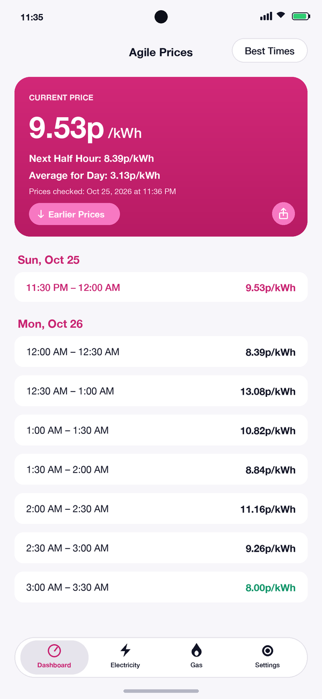
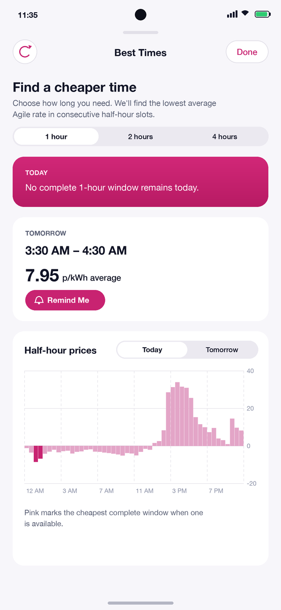
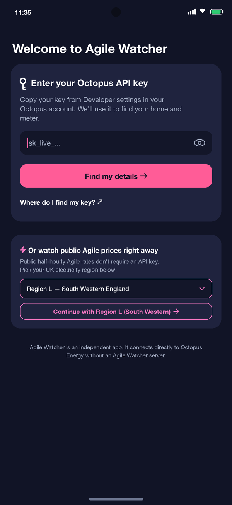
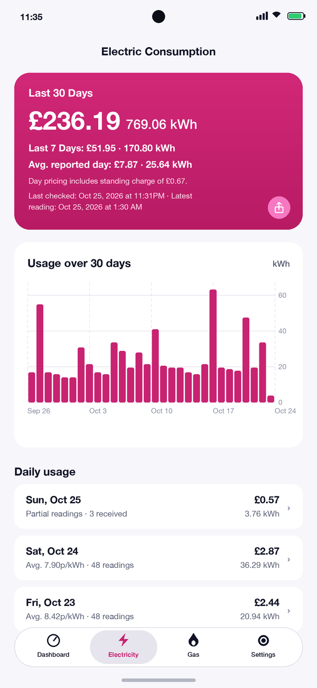
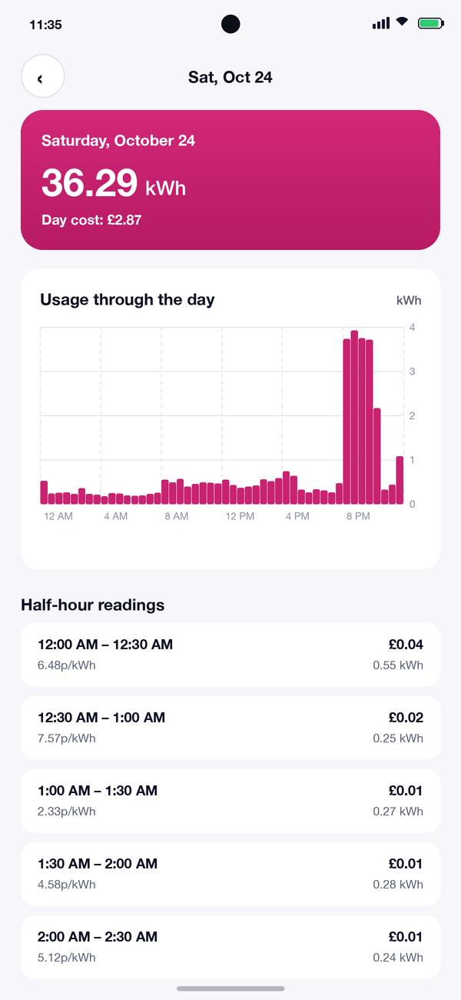
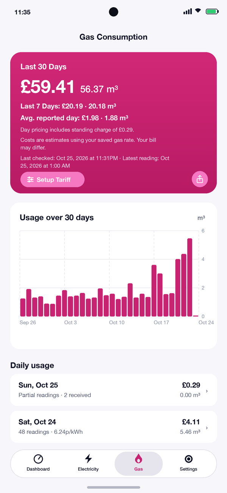

# ⚡ Octopus Energy Agile Watcher for Android

Agile Watcher for Android makes it easier to follow your Octopus Energy Agile electricity prices, find cheaper times to use power, and understand your energy use. Connect with your Octopus API key, check the home and meter details we find, and start watching your rates.

> **⚠️ Disclaimer & Non-Affiliation:**
> This project is an **independent, unofficial open-source Android recreation** inspired by the iOS app **[Octopus Energy Agile Watcher](https://www.robertsammons.com/agile-watcher/)** ([App Store `id1499880851`](https://apps.apple.com/gb/app/octopus-energy-agile-watcher/id1499880851)) created by **Rob Sammons**.
>
> **This project and its author are not affiliated with, endorsed by, or connected in any way to Octopus Energy (or Kraken Technologies) or Rob Sammons.** If you use iOS, iPadOS, macOS, or watchOS, please support Rob Sammons' official app on the [Apple App Store](https://apps.apple.com/gb/app/octopus-energy-agile-watcher/id1499880851).

---

## 📱 Screenshots

| Agile Prices Dashboard | Best Times Finder | Welcome & Onboarding |
| :---: | :---: | :---: |
|  |  |  |
| **Live rate, Next half hour, Daily average & Earlier Prices toggle** | **1h / 2h / 4h cheapest window finder, Remind Me & 48-bar price chart** | **API key auto-discovery or instant UK region public rate browsing** |

| 30-Day Electric Consumption | Electric Day Detail | 30-Day Gas Consumption |
| :---: | :---: | :---: |
|  |  |  |
| **30-day & 7-day usage/cost summary, bar chart & partial-day badges** | **48-bar half-hour usage chart & slot-by-slot Agile rate breakdown** | **SMETS2 (`m³`) / SMETS1 (`kWh`) gas tracking & Setup Tariff dialog** |

---

## ✨ Features

- **Current and upcoming prices:** See the live half-hour rate, the next rate, and prices ahead as Octopus publishes them (typically around 4:00 PM UK time daily). Public Agile rates for all 14 UK DNO regions (`A`–`P`) can also be browsed without an API key.
- **Best Times:** Find the cheapest consecutive **1 hour**, **2 hours**, or **4 hours** window across Today and Tomorrow, explore the 48-slot half-hour price chart, and set a local Android notification reminder for your chosen window.
- **Electricity usage:** Explore up to 30 days of daily costs and consumption, with 30-day and daily 48-bar charts and half-hour detail paired with the Agile rate at that time. Partial and missing readings are clearly labelled.
- **Optional gas usage:** View up to 30 days of gas consumption (`m³` for SMETS2 with standard UK calorific conversion to `kWh`, or `kWh` for SMETS1) and estimated costs. Import your gas tariff from your Octopus account when available, or enter it yourself via **Setup Tariff**.
- **Android Home Screen Widget:** Keep your current Agile rate, next half-hour rate, and daily average close at hand on your Android Home Screen.
- **Made for Android (Kotlin & Jetpack Compose):** Supports both Light and Dark appearances (plus System default), high-cost threshold alerts, standing charge inclusion toggle, and 2 or 3 decimal place formatting.
- **Privacy:** No advertising, tracking, or analytics. The app connects directly to the [Octopus Energy Kraken API](https://developer.oegb-kraken.energy/rest/) (`api.oegb-kraken.energy`) and your account details stay strictly on your device.

*Note: An Octopus Energy account and API key are required for smart meter consumption tracking. Export tariffs are not supported. Availability of gas tariff details depends on your Octopus account. Prices and usage costs shown in the app are estimates; your final bill may differ.*

---

## 🛠️ Setup & Zero-SDK Docker Build

Built in **Kotlin** with **Jetpack Compose (Material 3)** using the same zero-SDK Docker, Docker Compose, and GitHub Actions workflow as [`markmclaren/tuya-water-heater-app`](https://github.com/markmclaren/tuya-water-heater-app).

### Prerequisites

- **Docker Desktop** (for building locally — no local Java, Gradle, or Android SDK needed)
- Optional: An Octopus Energy account & API key from [Octopus Developer Settings](https://octopus.energy/dashboard/new/accounts/personal-details/api-access)

### 1. Optional Build-Time Configuration

You can enter your API key directly inside the app's Welcome / Settings screen on your phone, or optionally pre-populate it at build time via `.env` or `local.properties` (both are gitignored and never committed):

```bash
cp local.properties.example local.properties
# or
cp .env.example .env
```

### 2. Run Python Logic & Live API Verification Tests

```bash
python3 test_app_logic.py
```

### 3. Build the APK with Docker Compose

**Debug APK:**
```bash
./build_with_docker.sh
```
Outputs `app-debug.apk` in the project root.

**Release APK:**
```bash
./build_release_with_docker.sh
```
Outputs `app-release.apk` in the project root.

---

## 📁 Project Structure

```text
octopus-energy-agile-watcher-android/
├── .github/workflows/
│   └── build.yml                       # GitHub Actions CI & Release APK workflow
├── app/src/main/java/com/example/agilewatcher/
│   ├── data/
│   │   ├── AgileModels.kt              # GSP regions (A-P), Best Times, SMETS2 gas conversion
│   │   ├── OctopusApiClient.kt         # Kraken GraphQL auto-discovery & REST v1 client
│   │   └── AgileRepository.kt          # SharedPreferences persistence & concurrent refresh
│   ├── ui/
│   │   ├── AgileViewModel.kt           # StateFlow UI state & Best Times calculator
│   │   ├── AgileReminderReceiver.kt    # AlarmManager notification receiver for Remind Me
│   │   ├── AgileRateWidgetProvider.kt  # Android Home Screen AppWidgetProvider
│   │   ├── screens/
│   │   │   ├── OnboardingScreen.kt     # Welcome & API key auto-discovery
│   │   │   ├── DashboardScreen.kt      # Current price & half-hour list
│   │   │   ├── BestTimesScreen.kt      # 1h/2h/4h finder & 48-bar chart
│   │   │   ├── ConsumptionScreen.kt    # 30-day & Day Detail Electric/Gas
│   │   │   └── SettingsScreen.kt       # Account, Region, Gas Tariff & Theme preferences
│   │   └── theme/
│   │       ├── Color.kt                # Signature Agile Watcher Pink & Light/Dark palettes
│   │       ├── Theme.kt
│   │       └── Type.kt
│   └── MainActivity.kt                 # Floating 4-tab capsule navigation bar
├── Dockerfile                          # Isolated JDK 17 + Gradle 8.11.1 + Android SDK 35
├── docker-compose.yml                  # Persistent Gradle cache volume
├── build_with_docker.sh                # One-command Debug APK builder
├── build_release_with_docker.sh        # One-command Release APK builder
├── local.properties.example            # Template for optional build-time credentials
├── generate_screenshots.py             # Pillow vector generator for ./screenshots/*.png
└── test_app_logic.py                   # Unit & live Octopus API verification suite
```

---

## 🙏 Credits & Inspiration

- **[Octopus Energy Agile Watcher for iOS](https://www.robertsammons.com/agile-watcher/)** by **Rob Sammons** — The UI layout, workflow, and feature design of this Android app are directly inspired by Rob Sammons' iOS application.
- **[Octopus Energy Kraken REST & GraphQL APIs](https://developer.oegb-kraken.energy/rest/)** — Public tariff, product, and smart meter consumption APIs provided by Octopus Energy.
